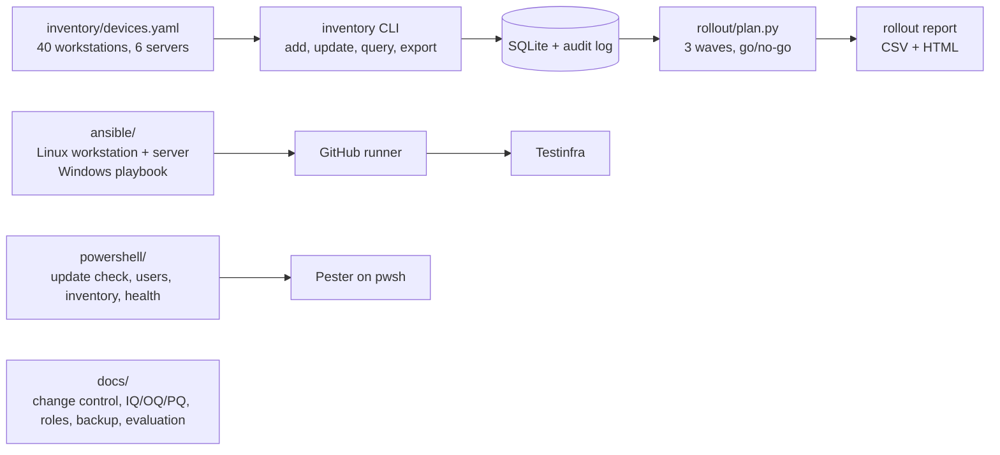

# IT Rollout Lab

IT infrastructure and rollout project for a **simulated** pharma-style plant: inventory with audit log, Ansible configuration, PowerShell tooling, a three-wave rollout simulation and pharma-style process documentation. Portfolio project for an IT working student role.



## Results

| Metric | Value |
|---|---|
| Simulated devices | 46 (40 workstations, 6 servers) |
| Eligible / excluded for rollout | 36 / 10 (servers, retired, in repair, spare) |
| Waves (pilot / early / rest) | 6 / 12 / 18 machines, all 3 waves go |
| Configured / observed failure rate | 0.12 / 0.103 (seed 2026) |
| Success / rollbacks / blocked | 27 / 2 / 7 (blocked = warranty expired) |
| Python tests, coverage | measured in CI (gate 85 %) |
| Testinfra, Pester | measured in CI |

The rollout numbers come from running the simulator with the default seed. Test counts and coverage are measured by the GitHub Actions run.

## Run

```bash
pip install -r requirements.txt
python -m inventory.cli init && python -m inventory.cli query --type server
python -m rollout.plan --out reports/rollout
pytest --cov
```

## Honest notes

- **All machines, users and data are simulated.** Hostnames, serials, owners and software versions are generated.
- **No real Windows host**: the Windows playbook is only linted and syntax-checked. PowerShell scripts run on pwsh on Linux against JSON fixtures.
- The Linux playbooks really run, but on the GitHub Actions runner, not on plant machines.
- **No real pharma environment. Not GxP validated.** IQ/OQ/PQ checklists and change control are learning material.
- **No real Azure** or other cloud resources are used.
